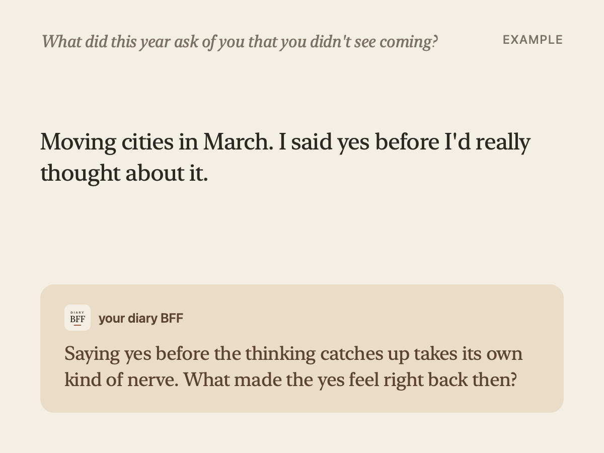
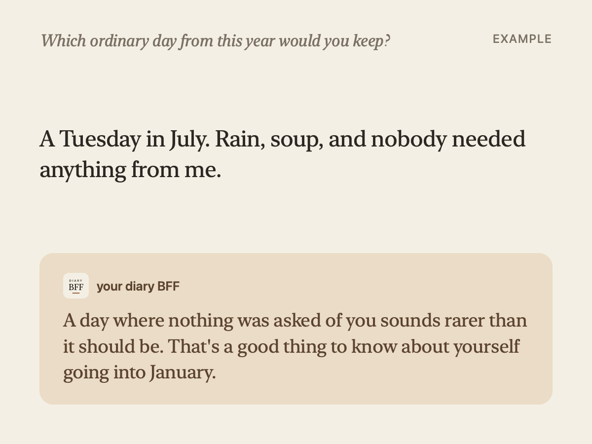
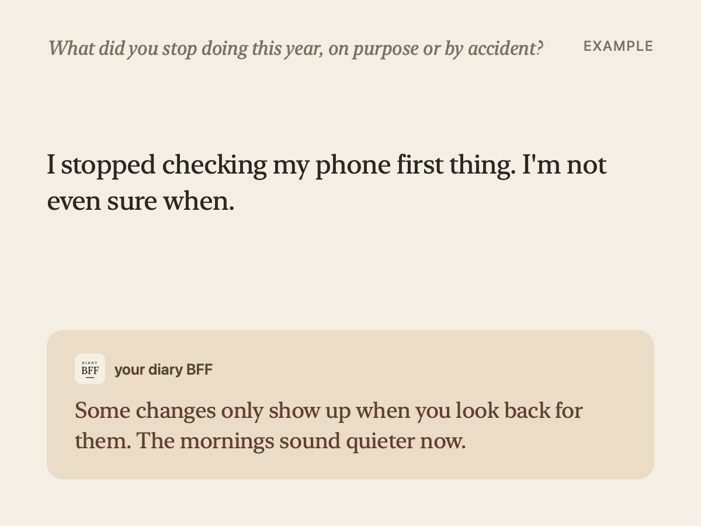
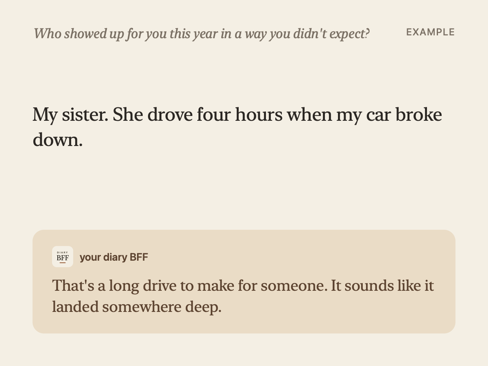
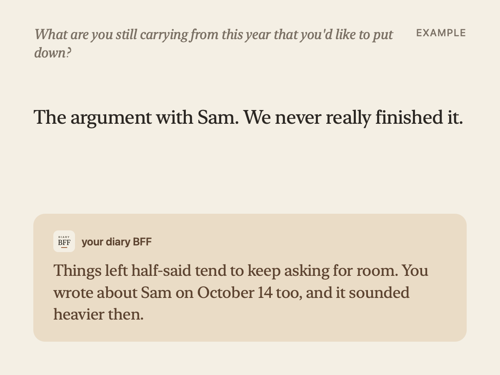
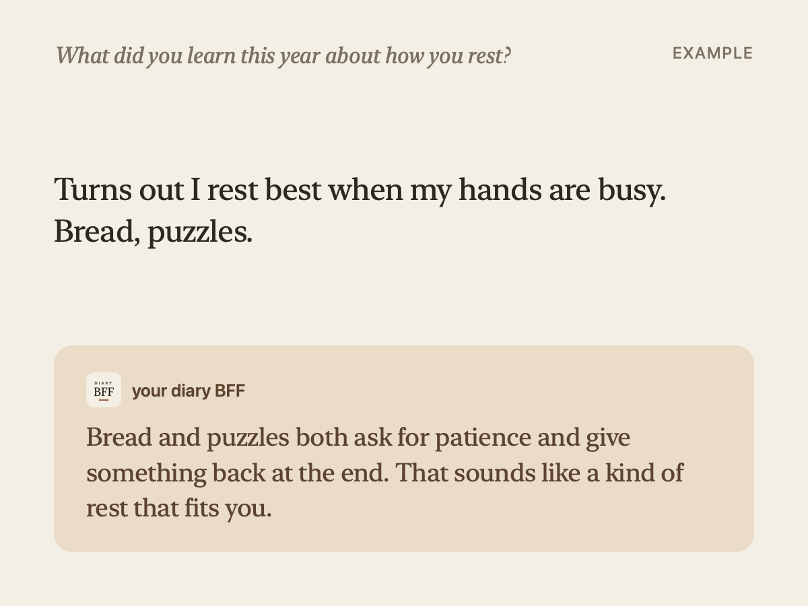
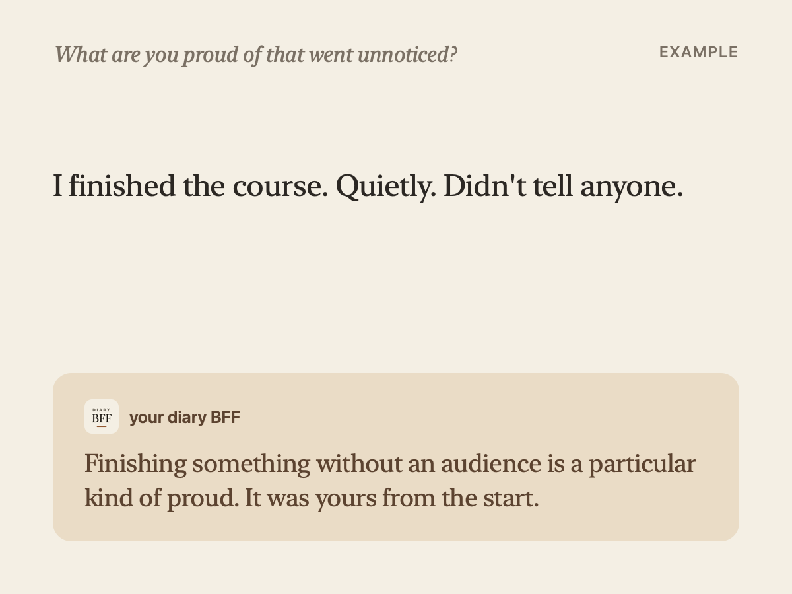
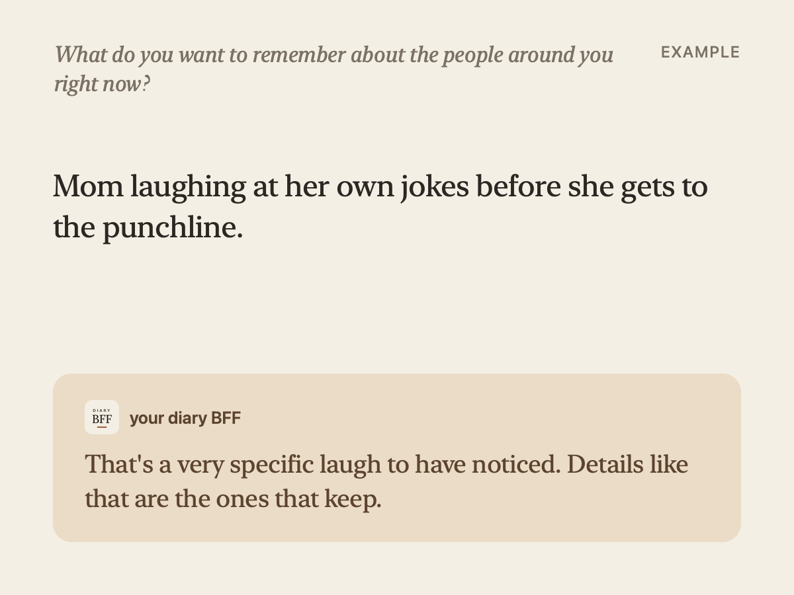
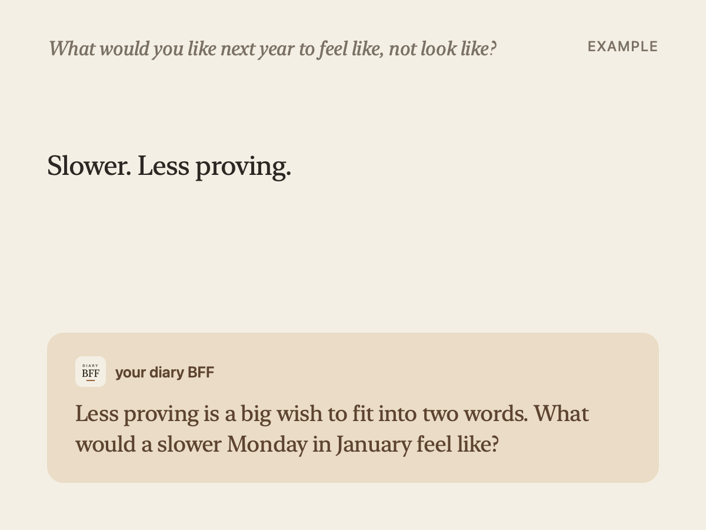
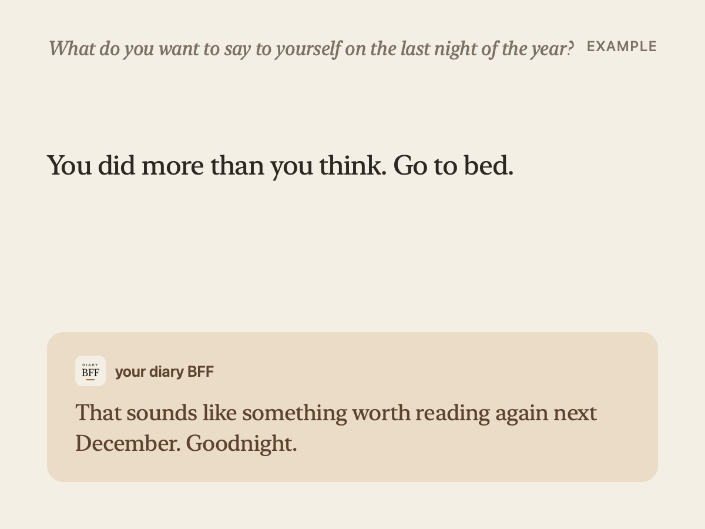

# End of year journal prompts for the last nights of December

End of year journal prompts work best one at a time. Not a worksheet to finish before midnight, just one question a night, a few lines underneath, and then bed.

Here are ten. Under each one is a small card: an example entry, and an example of how your diary BFF might write back if you tap **Ask**. We wrote the entries and the replies to show how it works. They aren't from anyone's real diary.

## 1. What did this year ask of you that you didn't see coming?

Start with the surprise, not the summary. It's easier to write about one thing than about twelve months.

> *Example entry:* Moving cities in March. I said yes before I'd really thought about it.
>
> *Example reply:* Saying yes before the thinking catches up takes its own kind of nerve. What made the yes feel right back then?

## 2. Which ordinary day from this year would you keep?

Not the big day. A plain one you'd happily live again.

> *Example entry:* A Tuesday in July. Rain, soup, and nobody needed anything from me.
>
> *Example reply:* A day where nothing was asked of you sounds rarer than it should be. That's a good thing to know about yourself going into January.

## 3. What did you stop doing this year, on purpose or by accident?

Some of the biggest changes are things that quietly went away.

> *Example entry:* I stopped checking my phone first thing. I'm not even sure when.
>
> *Example reply:* Some changes only show up when you look back for them. The mornings sound quieter now.

## 4. Who showed up for you this year in a way you didn't expect?

Write the moment, not the thank-you card.

> *Example entry:* My sister. She drove four hours when my car broke down.
>
> *Example reply:* That's a long drive to make for someone. It sounds like it landed somewhere deep.

## 5. What are you still carrying from this year that you'd like to put down?

You don't have to solve it tonight. Naming it is enough.

> *Example entry:* The argument with Sam. We never really finished it.
>
> *Example reply:* Things left half-said tend to keep asking for room. You wrote about Sam on October 14 too, and it sounded heavier then.

## 6. What did you learn this year about how you rest?

Rest looks different for everyone. Yours counts.

> *Example entry:* Turns out I rest best when my hands are busy. Bread, puzzles.
>
> *Example reply:* Bread and puzzles both ask for patience and give something back at the end. That sounds like a kind of rest that fits you.

## 7. What are you proud of that went unnoticed?

The quiet wins deserve a line too.

> *Example entry:* I finished the course. Quietly. Didn't tell anyone.
>
> *Example reply:* Finishing something without an audience is a particular kind of proud. It was yours from the start.

## 8. What do you want to remember about the people around you right now?

Small details fade first. Get one down.

> *Example entry:* Mom laughing at her own jokes before she gets to the punchline.
>
> *Example reply:* That's a very specific laugh to have noticed. Details like that are the ones that keep.

## 9. What would you like next year to feel like, not look like?

Goals can wait for January. Start with the feeling.

> *Example entry:* Slower. Less proving.
>
> *Example reply:* Less proving is a big wish to fit into two words. What would a slower Monday in January feel like?

## 10. What do you want to say to yourself on the last night of the year?

End the year in your own words.

> *Example entry:* You did more than you think. Go to bed.
>
> *Example reply:* That sounds like something worth reading again next December. Goodnight.

## How the replies work

Your diary BFF stays quiet while you write. When you tap **Ask**, it answers in a few sentences, with at most one question, right under your words. It doesn't hand you a list of advice.

Your diary BFF remembers what you wrote, with the date. So when something comes up again, a reply can point back to the night you first wrote about it, like the card about Sam above.

The replies aren't written by a person. Your diary BFF is an AI that lives in your diary.

## Private by design

- **It has its own PIN**, separate from your phone's passcode, with no Face ID shortcut. Someone holding your unlocked phone still can't open it.
- **Your entries are not used to train AI.**
- **There's no feed**, and no sign-up before you start.

Related: [journal prompts app](https://diarybff.app/journal-prompts-app/) · [reflection journal app](https://diarybff.app/reflection-journal-app/) · [weekly letter journal](https://diarybff.app/weekly-letter-journal/) · [Diary BFF](https://diarybff.app/)

## Try it tonight

Download Diary BFF, set a PIN, and try one question tonight. Your first reply comes with the app; more replies and the full Sunday letter are part of the full version.
